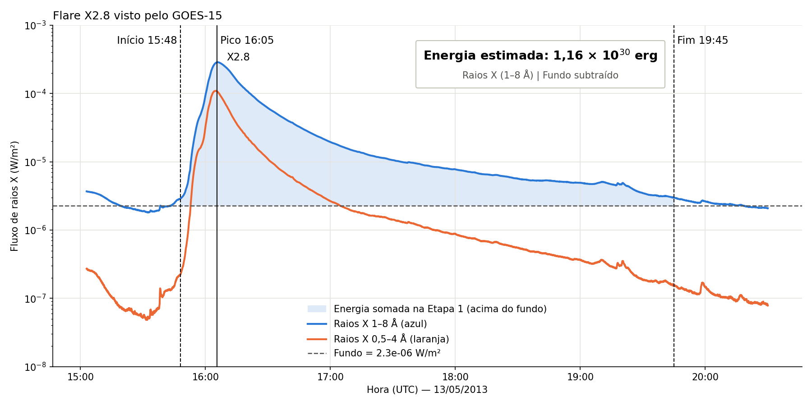

# Energia do flare X2.8 de 13/05/2013

## Objetivo

Estimar quanta energia em **raios X** o Sol emitiu durante o flare (explosão solar) X2.8 de 13 de maio de 2013.

## Dados utilizados

- **Satélite:** GOES-15, que fica em órbita da Terra e mede os raios X que chegam do Sol.
- **Arquivo:** `go1520130513.fits`, com uma medição a cada 2 segundos durante o dia todo.
- **O que ele mede:** quanta energia chega **por segundo** em **1 metro quadrado** (W/m²).
- **Faixa usada:** raios X de **1–8 Å**, a curva azul do gráfico. É a faixa usada para classificar flares.

| | Hora (UTC) |
|---|---|
| Início | 15:48 |
| Pico | 16:05 |
| Fim | 19:45 |
| Duração | ~4 horas |

- **Linha tracejada (fundo):** o nível de raios X que o Sol já emitia antes do flare, igual a 2,26 × 10⁻⁶ W/m². Esse valor é descontado no cálculo.
- **Área azul clara:** a energia que o flare acrescentou, que é o que vamos somar.

## Cálculo em três etapas

### Etapa 1: energia recebida por metro quadrado

O satélite mede energia **por segundo**. Para ter a energia total, fazemos três coisas:

1. Tiramos o fundo de cada medição, para contar só o que veio do flare.
2. Multiplicamos o valor de cada medição pelo tempo até a próxima (~2 s).
3. Somamos todos esses pedacinhos, do início ao fim do flare.

Essa soma é chamada de **integral do fluxo**. É a área azul do gráfico.

> **Resultado:** 0,411 J/m²

### Etapa 2: converter de joules para ergs

Joule e erg são duas unidades de energia. Em astronomia se usa muito o erg.

**1 joule = 10 milhões de ergs**

> 0,411 J/m² × 10.000.000 = **4,11 × 10⁶ erg/m²**

### Etapa 3: considerar a distância Sol–Terra

O satélite recebeu energia em só 1 m². Mas o Sol emitiu para **todos os lados**, como uma lâmpada no meio de uma sala.

Essa energia se espalhou numa esfera com raio igual à distância Sol–Terra (d = 1,496 × 10¹¹ m). Então multiplicamos o valor da Etapa 2 pela área dessa esfera:

> Área = 4 × π × d² = **2,81 × 10²³ m²**
>
> 4,11 × 10⁶ erg/m² × 2,81 × 10²³ m² = **1,16 × 10³⁰ erg**

## Resultado final

> **Energia irradiada em raios X (1–8 Å): 1,16 × 10³⁰ erg = 1,16 × 10²³ J**

Isso é aproximadamente a eletricidade que a humanidade inteira consome em **1.000 anos**, emitida pelo Sol em cerca de 4 horas.

Esse valor é só a energia em raios X na faixa de 1–8 Å. A energia total do flare é maior, porque ele também emite outros tipos de luz e lança partículas no espaço.
